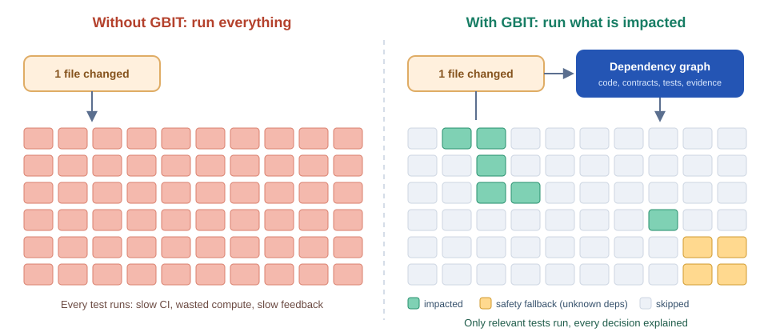

# GBIT — Graph-Based Impact Testing

Language-agnostic, plugin-driven test impact analysis. See [`docs/GBIT_Architecture_Proposal.html`](docs/GBIT_Architecture_Proposal.html) for the design and [`docs/roadmap`](docs/roadmap) for the plan.

> Status: scaffold only. No functionality is implemented yet.

## The problem

As a codebase grows, its test suite grows faster. Most CI pipelines react by running **every test on every change**, even when a pull request touches a single file. Feedback slows from minutes to hours, compute costs climb, and developers learn to ignore or re-run red builds.

Existing shortcuts each fall short:

- **Run everything:** safe but slow and wasteful.
- **Hand-curated test subsets or path filters:** fast but brittle, and they silently go stale.
- **Single-language "affected" tools** (for example Nx or pytest-testmon): useful, but they stop at one ecosystem and rarely explain why a test was skipped.

Real systems also cross boundaries. A change to an OpenAPI contract in a C# service can break a TypeScript client and a Python end-to-end suite, which a per-language tool cannot see.



## What GBIT aims to do

GBIT builds a versioned dependency graph of code, contracts, configuration and tests, using plugins for each language. For a given change it works out which tests provide evidence about the affected surface, runs only those through your existing runners (xUnit, pytest, Jest, JUnit), and explains every decision.

- **Correctness before speed:** unknown or dynamic dependencies widen the selection. An uncertain relationship never justifies skipping a test.
- **Language agnostic:** the core has no language-specific logic. Analyzers and runners are out-of-process plugins.
- **Cross-language impact:** contracts such as OpenAPI are first-class graph nodes.
- **Explainable:** every included or excluded test has a traceable reason.
- **Self-validating:** shadow mode compares its plan with full-suite runs to measure missed regressions before you rely on it.

GBIT orchestrates test selection; it does not replace your test frameworks. Targets such as a 50% median CI time reduction are goals to validate, not measured results. See the [architecture proposal](docs/GBIT_Architecture_Proposal.html) for details.

## Layout

| Path | Purpose |
|---|---|
| `src/Gbit.Core` | Language-neutral kernel: entities, graph, change model, impact, policy, planning, explanation |
| `src/Gbit.Protocol` | `gbit.plugin/v1` JSON-RPC over stdio contracts and transport |
| `src/Gbit.Storage.Sqlite` | SQLite graph store |
| `src/Gbit.Cli` | `gbit` command-line tool |
| `tests/Gbit.Core.Tests` | Unit tests |
| `tests/Gbit.Conformance` | Executable specification: graph fixtures, scenarios, protocol tests |
| `plugins/` | Out-of-process analyzers, runners and contract plugins |
| `ci/` | Thin CI provider wrappers |

## Build

```bash
dotnet build
dotnet test
```

## Contributing

Contributions are welcome. Start with [CONTRIBUTING.md](CONTRIBUTING.md) and pick a task from the [roadmap](docs/roadmap). Please open an issue before starting large changes.

## License

Released under the [MIT License](LICENSE).
